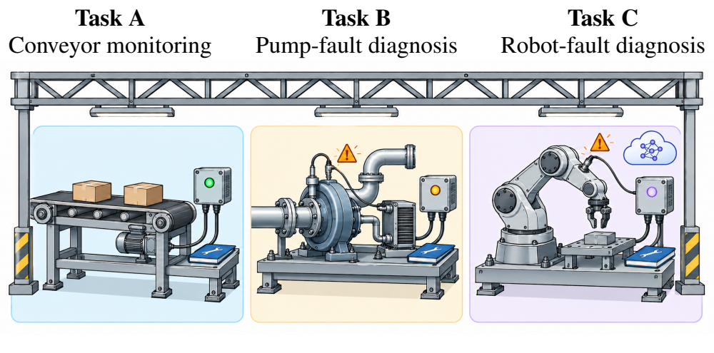
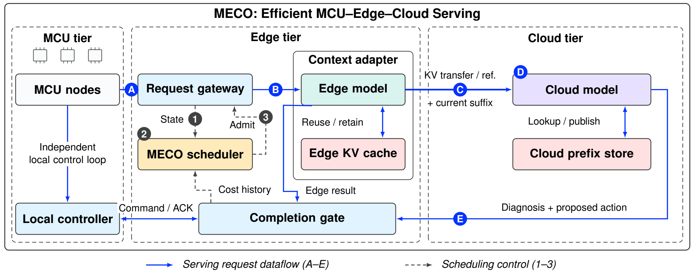
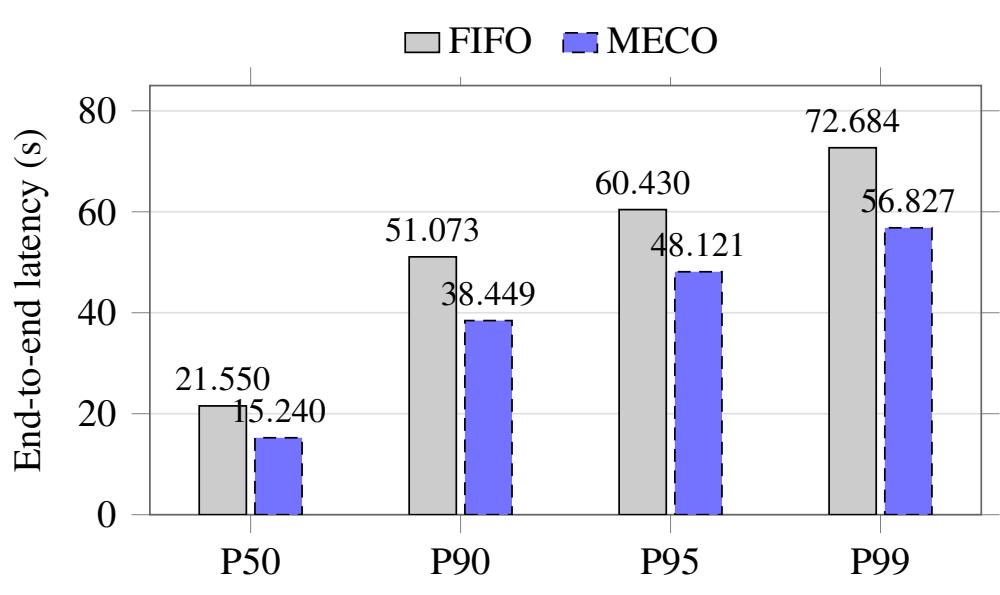

# MECO: An Efficient MCU–Edge–Cloud System for Factory Maintenance

## Application Scenario

MECO supports conveyor monitoring, pump-fault diagnosis, and robot-fault diagnosis in factories through a hierarchy of MCU devices, an edge CPU, and a cloud GPU. Each request combines a device identity, current sensor observations, and equipment maintenance knowledge. Maintenance rules and operating instructions remain relatively stable, while temperature, current, pressure, vibration, and other observations vary between tasks.

MCUs collect observations and maintain local control. A small model at the edge produces an upstream diagnosis, and selected tasks continue to a larger model on the GPU. Transferring the computed KV state reduces repeated downstream prefill. Returned diagnoses are checked against the device identity, session, and action preconditions before they affect the device, completing the loop from observation to validated action.



*Figure 1. Three factory maintenance tasks: conveyor monitoring, pump-fault diagnosis, and robot-fault diagnosis.*

## System Architecture



*Figure 2. MECO system overview. Blue steps A–E show the serving path, and black steps 1–3 show scheduling control.*

Device observations enter the edge service through the request gateway. The small CPU model first processes the maintenance context and current task. Tasks completed at the edge return directly to the completion gate. For tasks requiring further diagnosis, the mapping module transforms the complete upstream KV state into the layer and attention-head layout of the larger GPU model, which then continues generation. Both paths validate the response format, device session, and action preconditions before receiving an MCU acknowledgement. Local control continues independently throughout inference.

Figure 2 presents the paper's overall design, including context reuse and scheduling control. This repository implements the complete-KV cascade serving path. The CPU and GPU each use a FIFO queue, with one request executing per stage and overlap permitted across different requests. Each GPU-bound task transfers its complete upstream KV state and resumes from the unconsumed token and follow-up prompt. The cross-request prefix store and locality-aware reordering shown in the paper are outside this streamlined implementation. Routing currently uses the input field `sensor_valid`: tasks with invalid readings finish on the CPU, while the remaining tasks continue to the GPU.

## Hardware and Software

The hardware, operating system, and upstream and downstream models correspond to the deployment described in Section 3.6 of the paper.

| Tier | Hardware and resources | Software and responsibilities |
|---|---|---|
| MCU | 3 emulated STM32F407 nodes, each with 1 MiB Flash and 128 KiB SRAM | C firmware in Renode; observations, commands, and CRC-protected acknowledgements over USART2 socket terminals |
| Edge CPU | Intel Core i9-14900KF, with 4 cores allocated | Asynchronous Python gateway and upstream inference with Qwen2.5-Coder-1.5B-Instruct |
| Cloud GPU | NVIDIA GeForce RTX 4090 with 24 GB of GPU memory | Downstream inference with Qwen2.5-Coder-7B-Instruct and mapping of imported upstream KV state |
| Operating system | Ubuntu 24.04.4 LTS | Hosts the gateway, model services, and device emulation |

The implementation uses Python 3.12, FP32 CPU inference, and FP16 GPU inference. KV tensors are serialized in FP16 using safetensors. The gateway, CPU service, and GPU service use separate Python environments, with dependency versions pinned in `requirements/`. MCU firmware is compiled with the ARM GNU toolchain and runs in Renode 1.17.0. The launcher supports Linux/WSL2, and model services communicate over local HTTP. Default CPU affinities assign logical CPUs 0–3 to upstream inference, 4–7 to the GPU service's host threads, and 8–9 to Renode. These assignments are configurable.

## Repository Structure

```text
MECO-system-core-20261015/
├── meco/
│   ├── strategy/       # Input routing, stage FIFO, token continuation boundaries
│   ├── inference/      # CPU/GPU inference, model identities, HTTP services
│   ├── kv/             # Cross-model KV mapping and RoPE transformations
│   ├── transport/      # Metadata and KV framing, decoding, and digests
│   ├── device/         # CRC protocol, asynchronous UART, response validation
│   ├── runtime/        # Task pipeline, service lifecycle, system launcher
│   └── __main__.py     # Entry point for python -m meco
├── mcu/
│   ├── firmware/       # STM32F407 firmware and linker script
│   ├── renode/         # Emulated platform description
│   └── build.sh        # Firmware build for a specified device ID
├── config/             # Interpreter paths, weights, ports, and CPU affinities
├── requirements/       # Gateway, CPU, and GPU dependencies
├── assets/             # Paper Figures 1, 2, and 6 used in this README
└── README.md
```

`meco/runtime/pipeline.py` connects observation upload, CPU inference, optional GPU continuation, and MCU acknowledgement. `meco/strategy/continuation.py` identifies the cached prefix and remaining suffix, while `meco/kv/mapper.py` maps KV state between models. `meco/device/uart.py` binds requests and returned actions to a specific device session.

## Results

The following results are reported in the paper. The synthetic workload covers three device classes and 12 maintenance-rule documents, with 4 configuration variants per class. Each seed generates 256 tasks with Poisson arrivals at 0.6 requests per second, and 5 seeds are evaluated. End-to-end latency runs from scheduled arrival to MCU acknowledgement and includes both correct and incorrect outcomes. Percentiles are computed separately for each seed and then averaged arithmetically across the 5 seeds.



*Figure 6. End-to-end latency across all receipts, in seconds.*

Compared with FIFO, MECO reduces P50, P90, P95, and P99 latency by **29.28%, 24.72%, 20.37%, and 21.82%**, respectively. Overall accuracy changes from **90.23%** for FIFO to **89.84%** for MECO, a decrease of **0.39 percentage points**. FIFO performs full prefill on the GPU-bound context, whereas MECO continues from transferred upstream KV state. These results describe the overall latency–accuracy tradeoff and do not isolate a scheduling benefit.

**Table 1. Reported mean and peak component power.**

| Component | Mean power (W) | Peak power (W) |
|---|---:|---:|
| MCU (3 nodes in total) | 0.06435 | 0.10890 |
| Edge CPU | 61.60 | 66.96 |
| Cloud GPU (RTX 4090) | 78.64 | 256.56 |

MCU values are scenario estimates for the three emulated nodes. CPU and GPU values summarize sensor readings from their respective observation windows. The reported mean-power ratio is approximately **1:957:1222**. It indicates the relative scale of component power rather than a synchronized measurement of total system power.

## Deployment

On Ubuntu or WSL2, install a CUDA-compatible NVIDIA driver, Renode, and `arm-none-eabi-gcc`. Place the repository in a path without spaces. From the repository root, create three Python environments and install their dependencies:

```bash
python3.12 -m venv "$HOME/meco-env-gateway"
python3.12 -m venv "$HOME/meco-env-cpu"
python3.12 -m venv "$HOME/meco-env-gpu"

"$HOME/meco-env-gateway/bin/pip" install -r requirements/gateway.txt
"$HOME/meco-env-cpu/bin/pip" install -r requirements/cpu.txt
"$HOME/meco-env-gpu/bin/pip" install -r requirements/gpu.txt
```

Prepare the model snapshots and the selected mapping weights before starting the services. Store the following pinned model revisions in the standard snapshot directories under `$HOME/.cache/huggingface/hub`. The mapping directory must contain `manifest.json` and 28 layer safetensors files from the selected mapping checkpoint. Model identities and the mapping-weight version are pinned in `meco/inference/models.py` and checked at service startup.

| Model | Pinned revision |
|---|---|
| `Qwen/Qwen2.5-Coder-1.5B-Instruct` | `2e1fd397ee46e1388853d2af2c993145b0f1098a` |
| `Qwen/Qwen2.5-Coder-7B-Instruct` | `c03e6d358207e414f1eca0bb1891e29f1db0e242` |

Copy the example configuration and edit it to set the CPU and GPU interpreter paths, the Renode path, and CPU affinities appropriate for the host. Set the mapping-weight directory and launch the system:

```bash
cp config/system.example.json config/system.json
export MECO_MAPPER_DIR=/path/to/newweights/mapper

"$HOME/meco-env-gateway/bin/python" -m meco \
  --config config/system.json \
  --tasks /path/to/tasks.json \
  --output /path/to/new-runtime-output
```

`tasks.json` accepts either a task list or an object containing a `requests` list. Each task supplies `uid`, `device_id`, `sample_sequence`, `family`, `document_id`, `observation`, and `input_ids`. Device IDs 1, 2, and 3 correspond to conveyors, pumps, and robotic arms. Encode task prompts into `input_ids` using the pinned tokenizer. The optional `arrival_ms` field specifies relative arrival time, and the generation budget is 96 tokens. The output directory must not already exist. The launcher compiles firmware for all three devices, starts the model services and Renode, and writes task responses and MCU acknowledgements to `responses.jsonl`.
